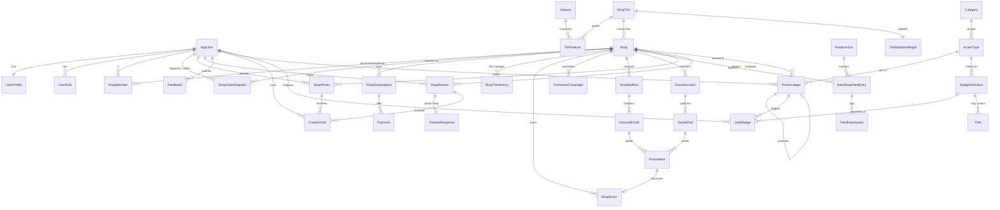

# NTCA Database Schema: Karma, Badges, Shop Tiers and New-Shops Rotation
**Target:** Microsoft SQL Server 2019+ · **DDL:** `ntca_schema.sql` (36 tables, 8 views, 7 procs, 1 trigger, seed data) · **Draft:** 2026-10-22

> **Baseline:** I couldn't find an earlier NTCA database schema in the site repo (`wtesolutions/client_tradingcardsassociation`, a static GitHub Pages site), the workspace, or past bot work, so this design starts from scratch. It reuses what exists today: the supporter tiers in `join.html` and the columns of `hobby-shop-directory.csv` (Shop Name, Address, City, State, Zip, Phone, Dealer Rating, Source).
>
> Items marked **(Suggested)** go beyond what was asked; drop them if they aren't wanted. Point values, caps and badge thresholds are starting defaults stored as data, so they can be tuned without code changes. **PAID and PREMIUM prices are NULL (TBD).**

**Conventions:** Seven schemas (`core`, `dir`, `bill`, `mkt`, `feed`, `ugc`, `karma`). Keys are BIGINT identity, plus a `PublicId UNIQUEIDENTIFIER` for anything exposed in URLs. All timestamps are `DATETIME2(3)` in UTC, text is `NVARCHAR`, and status columns are constrained with CHECKs.

---

## 1. Users and Profiles (`core`)
| Table | Purpose / key columns |
|---|---|
| `AppUser` | Login identity: Email, **EmailVerifiedAt** (karma requires a verified email), Username, AccountStatus (ACTIVE/SUSPENDED/BANNED/DELETED), **KarmaStatus** NORMAL/PROBATION/FROZEN **(Suggested)**, MembershipLevel (NTCA supporter level), IsStaff |
| `UserProfile` | Bio, avatar, home city/state, favorite hobbies, **ShowKarma / ShowBadges** privacy toggles |
| `UserRole` **(Suggested)** | Site roles ADMIN / MODERATOR / EDITOR, kept separate from shop roles |

## 2. Hobby-Shop Directory and the Three Tiers (`dir`)
Tier rules are stored as data rather than hard-coded:

| Table | Purpose |
|---|---|
| `ShopTier` | FREE (price 0), PAID (price TBD), PREMIUM (price TBD) |
| `Feature` / `TierFeature` | Feature catalog and the features each tier gets, with an optional monthly limit |
| `Shop` | Listing: address, lat/lng, phone, Website/Email/Facebook/Instagram (**always stored, shown only when the tier allows**), PrimarySpecialty, **CurrentTierId**, **ClaimStatus** (UNCLAIMED/PENDING/CLAIMED), ListingStatus, Source (e.g. Beckett Marketplace import), SuggestedByUserId, CoverPhotoId, **PublishedAt** (drives the rotation), ClaimedAt |
| `ShopMember` | OWNER / MANAGER / STAFF from an approved claim. Each shop can have only one active owner. This table is also what blocks owners from earning karma on their own shop |
| `ShopClaimRequest` | Claim/adoption workflow. ClaimType OWNER, or ADOPTER **(Suggested: a community member who maintains an unclaimed listing)**. Statuses PENDING → VERIFYING → APPROVED/REJECTED/WITHDRAWN/EXPIRED. Verification can be by email domain, phone, postcard code, document, social DM or admin, and only a code hash is stored. **ReferredByUserId** credits the member who brought the owner in; self-referral is blocked |

**Tier matrix (seeded):**

| Feature | FREE | PAID | PREMIUM |
|---|:-:|:-:|:-:|
| Basic listing (name, address, phone, photos, reviews) | ✔ | ✔ | ✔ |
| Website link / email link | – | ✔ | ✔ |
| Social links | – | ✔ (Suggested) | ✔ |
| Reply to reviews | – | ✔ (Suggested) | ✔ |
| Event calendar (`mkt.ShopEvent`) | – | – | ✔ |
| Email promotion / social promotion | – | – | ✔ (4 per month each, Suggested) |
| Mailbox parsing | – | – | ✔ |
| Facebook/Instagram monitoring | – | – | ✔ |
| Rotation boost | – | – | ✔ |

`dir.vw_ShopPublicListing` returns NULL for website, email and social fields unless the shop's tier includes them. Free listings therefore never leak links, and an upgrade shows them instantly with no data change. `dir.vw_ShopEntitlement` lists each shop's live entitlements for app checks.

## 3. Subscriptions and Billing (`bill`)
| Table | Purpose |
|---|---|
| `ShopSubscription` | Stripe-style subscription: TRIALING/ACTIVE/PAST_DUE/CANCELED/EXPIRED, interval MONTH/YEAR/COMP, external IDs. **One live subscription per shop** |
| `Payment` | Invoices/payments (amount in cents, status) |
| `ShopTierHistory` | Audit trail of every tier change (INITIAL/UPGRADE/DOWNGRADE/PAYMENT_LAPSED/CANCELED/COMP/ADMIN) |

## 4. Premium Features (`mkt`)
| Table | Feature |
|---|---|
| `ShopEvent` | **Calendar**: card shows, release days, trade nights, tournaments, signings, breaks. Supports iCal RRULE recurrence and a time zone. SourceType records where the event came from: MANUAL / MAILBOX / FACEBOOK / INSTAGRAM / IMPORT |
| `PromotionCampaign` | **Email and social promotion** (EMAIL, FACEBOOK, INSTAGRAM, X, SITE_FEATURE, NEWSLETTER), with staff approval before anything is sent and open/click metrics |
| `ShopMailbox` → `InboundEmail` | **Mailbox parsing**: each shop gets `{slug}@in.tradingcardsassociation.com` (or forwards its own inbox). Emails are deduplicated on Message-ID, and the raw .eml is kept in blob storage |
| `SocialAccount` → `SocialPost` | **Facebook/Instagram monitoring**: handles and poll status. Only a vault reference to tokens is stored, never the tokens themselves |
| `ParsedItem` | Structured item (EVENT / PRODUCT_RELEASE / PROMOTION / HOURS_CHANGE) extracted from exactly one email or post, with JSON, a confidence score and a review status. Approved items become `ShopEvent`s |

## 5. New-Shops Rotation Feed (`feed`)
| Object | Purpose |
|---|---|
| `RotationSlot` | Places the feed appears: HOME_NEW_SHOPS (6 shops, 30-day window), DIRECTORY_SIDEBAR (4), NEWSLETTER (8). Slot sizes are suggested |
| `TierRotationWeight` **(Suggested)** | FREE ×1.0 for 30 days · PAID ×1.5 for 45 days · PREMIUM ×2.5 for 60 days. Free shops always rotate in; paid tiers appear more often and for longer |
| `NewShopFeedEntry` | A shop's eligibility window in a slot. Reasons: NEW_LISTING / NEWLY_CLAIMED / TIER_UPGRADE / STAFF_PICK / GRAND_OPENING. Has a base weight and a pin flag. Only one active entry per slot and shop |
| `FeedImpression` | What was shown, in which position, and whether it was clicked. Anonymous visitors are recorded as a session hash, never a raw IP |
| `vw_NewShopRotation` | Eligible entries now, with **EffectiveWeight = base × tier multiplier × freshness**. Freshness decays linearly from 1.0 to 0.25 across the window |
| `usp_RefreshNewShopFeed` | Scheduled job: expires old entries and adds newly published or newly claimed active shops |
| `usp_GetNewShopRotation` | Serves a slot: pinned entries first, then a **weighted random** pick (Efraimidis–Spirakis), so each page view gets a fair, varied mix. Logs impressions |

## 6. User-Generated Content (`ugc`)
| Table | Purpose |
|---|---|
| `ShopPhoto` | Photos of hobby shops. **SHA-256 ContentHash is unique per shop** to stop re-uploads; PerceptualHash catches near-duplicates **(Suggested)**. Moderation PENDING/APPROVED/REJECTED/REMOVED. Also tracks WasFirstApprovedForShop and up/down vote counts |
| `ShopReview` | Rating 1–5, body, visit date. **One live review per user per shop.** AutoApproved flag (from a karma perk). Helpful/unhelpful counts |
| `ReviewResponse` **(Suggested)** | Owner reply to a review (PAID/PREMIUM) |
| `Feedback` | LISTING_CORRECTION / SHOP_CLOSED / NEW_SHOP_SUGGESTION / EVENT_TIP / SITE_FEEDBACK, with ProposedChangesJson. ResultingShopId links a suggestion to the shop it created |
| `ContentVote` | Photo up/down votes and review helpful/unhelpful votes: one per voter per item, and changeable |
| `ContentReport` **(Suggested)** | User flags (spam, fake, conflict of interest, …) |
| `ModerationAction` | Audit log of every moderator decision, including karma freezes, badge revokes and point adjustments |

## 7. Karma Points (`karma`), modeled on Reddit
| Object | Purpose |
|---|---|
| `Category` | PHOTO · REVIEW · FEEDBACK · SHOP_HELP · COMMUNITY. Like Reddit's post/comment split, profiles show karma per category plus a total |
| `ActionType` | **Rules table.** Each action has its points plus DailyPointCap, CooldownSeconds, PerShopLifetimeCap, RequiresModeration and BlockOnOwnShop |
| `PointsLedger` | **The points history: who earned what, when, for which action, from which content, at which shop.** Columns: UserId, ActionCode, CategoryCode, Points (±), SourceType + SourceId, ShopId, **SourceKey (UNIQUE, so the same award can't be paid twice)**, ReversesLedgerId, Reason, CreatedByUserId, CreatedAt |
| `TR_PointsLedger_AppendOnly` | Blocks UPDATE and DELETE on the ledger. Corrections are new negative rows that point to the original |
| `vw_UserKarmaByCategory` | **Indexed (materialized) view**: SQL Server keeps per-user, per-category totals up to date, so profile reads are instant and there's no balance column that can drift |
| `vw_UserKarma` | Profile view: Photo, Review, Feedback, ShopHelp, Community and Total karma |
| `vw_UserKarmaMonthly` | Karma over time, for profile charts and monthly leaderboards |
| `usp_AwardPoints` | Single entry point for awarding points. It checks eligibility, takes a per-user lock, and applies duplicate, cooldown, per-shop cap and daily cap checks (a partial award up to the cap is allowed). It then inserts the ledger row and evaluates badges. It returns AWARDED, DUPLICATE, CAPPED, COOLDOWN, SELF_SHOP, SHOP_CAP, INELIGIBLE or INACTIVE_ACTION |
| `usp_ReverseForSource` | Takes points back for a single ledger row, or for every award tied to a piece of content (for example, a photo removed later) |

**Seeded actions (suggested defaults):**

| Action | Pts | Daily cap | Other limits |
|---|--:|--:|---|
| PHOTO_APPROVED | 5 | 50 | 30s cooldown; max 10 per shop |
| PHOTO_FIRST_FOR_SHOP | 10 | – | once per shop |
| PHOTO_UNCLAIMED_SHOP_BONUS | 3 | 15 | only for UNCLAIMED + FREE shops |
| PHOTO_UPVOTE_RECEIVED / DOWNVOTE | +1 / −1 | 50 / – | – |
| REVIEW_APPROVED | 10 | 50 | 5-min cooldown; 1 per shop |
| REVIEW_DETAILED_BONUS | 5 | 25 | 1 per shop |
| REVIEW_HELPFUL_RECEIVED / UNHELPFUL | +1 / −1 | 50 / – | – |
| FEEDBACK_ACCEPTED | 3 | 15 | – |
| LISTING_CORRECTION_ACCEPTED | 5 | 25 | max 3 per shop |
| EVENT_TIP_ACCEPTED | 3 | 15 | – |
| NEW_SHOP_SUGGESTION_ACCEPTED | 15 | 60 | – |
| CLAIM_REFERRAL_APPROVED | 25 | – | once per shop |
| BADGE_BONUS / ADMIN_ADJUSTMENT | 0 / ± | – | admin adjustments require a reason and an actor |

Points are awarded only when content is **approved or accepted**, not when it is submitted.

## 8. Badges (`karma`)
| Object | Purpose |
|---|---|
| `BadgeDefinition` | BadgeCode, Name, Description, **BadgeFamily + BadgeLevel** (tiered badges such as Photo I/II/III), IconUrl. CriteriaType is ACTION_COUNT / CATEGORY_KARMA / TOTAL_KARMA / DISTINCT_SHOPS / DISTINCT_STATES / ACCOUNT_AGE_DAYS / MANUAL, with ActionCode/CategoryCode and Threshold. Also BonusPoints **(Suggested)**, DisplayOrder, IsSecret and IsActive |
| `UserBadge` | One award per user per badge. Records AwardedAt, AwardSource (RULE/MANUAL/BACKFILL) and **TriggerLedgerId** (the action that earned it). **IsDisplayed** and **PinOrder 1–3** control the badges featured next to the username. Moderators can revoke a badge, but a reason is required |
| `usp_EvaluateBadges` | Runs after every award. Counts are **net of reversals**, so removed content doesn't count. Badges aren't auto-revoked if counts drop later, which matches Reddit's permanence; moderators can revoke |

**Seeded badges:** First Snapshot (first photo) · Shutterbug (10 photos) · Shop Photographer (50) · Trailblazer (first photo of a shop) · First Review · Regular (10 reviews) · Critic (50) · Trusted Voice (100 helpful votes) · Road Trip (reviews in 5 states) · Shop Hopper (25 different shops) · Shop Scout (suggested shop added) · Matchmaker (owner referral approved) · Fact Checker (10 corrections) · Rookie Card / All-Star / Hall of Famer (100 / 1,000 / 10,000 karma) · One-Year Club · Founding Member (staff-awarded).

Badge names are placeholders for NTCA to rename. ONE_YEAR is checked whenever a user earns points; a nightly `usp_EvaluateBadges` sweep would also catch inactive users **(Suggested)**.

**Profile display:** `vw_UserKarma`, plus `UserBadge` rows that aren't revoked and have IsDisplayed = 1, ordered by PinOrder and then DisplayOrder, joined to `BadgeDefinition` for name and icon. Both respect `UserProfile.ShowKarma / ShowBadges`.

## 9. How Karma Ties Into the Directory and Tiers
- **Every ledger row carries `ShopId`**, so karma is traceable to the shop it helped.
- **Unclaimed free shops are where the community does the most work.** Photographing them earns PHOTO_UNCLAIMED_SHOP_BONUS, and the Trailblazer badge goes to whoever posts a shop's first photo. Members can also suggest missing shops (NEW_SHOP_SUGGESTION_ACCEPTED → Shop Scout) and fix listings (LISTING_CORRECTION_ACCEPTED → Fact Checker).
- **Claims and adoption:** when an owner claim that names `ReferredByUserId` is approved, the referrer earns CLAIM_REFERRAL_APPROVED (Matchmaker badge). ADOPTER claims let trusted members look after an unclaimed listing **(Suggested)**.
- **Claimed and paid shops:** owners, managers and staff **earn no karma on their own shop** (BlockOnOwnShop), and their votes on its content move the counters but not anyone's karma. Paid tier status never buys karma: tiers control **visibility** (links, calendar, promotion, rotation weight), while karma measures **member contribution**.
- **Shop community score (Suggested):** `dir.vw_ShopCommunityScore` sums member karma earned at each shop (total, last 30 days, distinct contributors). It could drive "most active shops" lists or help sales spot free shops worth pitching an upgrade. Shops don't hold karma themselves.
- **Rotation:** new and newly claimed shops enter the feed whatever their tier; tier only changes weight and window length.

## 10. Karma-Gated Perks (`karma.Perk`, `vw_UserPerk`) **(Suggested)**
| Perk | Requirement |
|---|---|
| AUTO_APPROVE_REVIEWS | ≥150 REVIEW karma, account ≥60 days, 0 removals in 90 days |
| AUTO_APPROVE_PHOTOS | ≥150 PHOTO karma, account ≥60 days, 0 removals in 90 days |
| DIRECT_LISTING_EDITS | ≥1,000 total karma, account ≥180 days, 0 removals |
| PRIORITY_FLAGS | ≥250 total karma, account ≥30 days, ≤1 removal |

Perks are evaluated live, so losing karma or getting content removed drops the perk automatically.

## 11. Anti-Gaming Safeguards
1. **No points until a moderator approves or accepts the content**, and points are reversed if it is removed later (`usp_ReverseForSource`; also reverse vote karma on that content).
2. **Idempotent awards:** the unique `SourceKey` means a retried job or double-click can't pay twice. Concurrent duplicates are caught (errors 2601/2627) and reported as DUPLICATE.
3. **Append-only ledger:** UPDATE and DELETE are blocked by trigger. Every correction is a visible, reasoned reversal row, and each original can be reversed only once.
4. **Rate limits per action:** daily point caps, cooldowns and per-shop lifetime caps, enforced under a per-user application lock so parallel requests can't race past them.
5. **No self-dealing:** no karma on your own shop; no voting on your own content (the proc rejects it); votes from shop staff carry no karma; self-referral is blocked by a CHECK.
6. **Verified email required** to earn, and to cast votes that carry karma. Suspended or banned accounts earn nothing.
7. **Duplicate-photo guard:** SHA-256 must be unique per shop, plus a perceptual hash for near-duplicates **(Suggested)**.
8. **One review per user per shop**, and one vote per voter per item; changing a vote reverses the earlier karma.
9. **Karma freeze (Suggested):** `KarmaStatus = FROZEN` stops all earning without banning the account, and every moderator action is logged in `ModerationAction`.
10. **Perks require clean history:** account age plus a removal count, not karma alone.
11. **Monitoring queries (Suggested):** watch for vote rings (the same voter→author pairs repeating), sudden spikes in `vw_UserKarmaMonthly`, and many accounts on one session hash.

## 12. ER Diagram

## 13. Validation
- **Microsoft ScriptDom (`TSql160Parser`, the SQL Server 2022 grammar):** the full script parses with **0 errors**: 93 batches, 120 statements (36 CREATE TABLE, 42 CREATE INDEX, 8 views, 7 procs, 1 trigger, 7 schemas, 9 seed inserts).
- **sqlfluff 4.4 (tsql dialect):** every section parses with 0 unparsable segments.
- **Script check:** every FK, view, proc and EXEC reference points to an object created earlier in the script.
- **Not done:** the script has not been run against a live SQL Server, because there is no SQL Server instance on the build box. Run it on a scratch database first. Things only a live server checks are the indexed-view and filtered-index SET options and constraint semantics.

## 14. Open Questions for NTCA
- PAID and PREMIUM pricing, and whether social links and review replies belong in PAID or only PREMIUM.
- Final point values, caps, badge names and icon artwork.
- Whether karma is shown publicly on profiles by default (currently on, and users can opt out).
- Whether perks such as auto-approve are wanted at launch.
- The `MembershipLevel` values needed to match the join.html supporter tiers.
